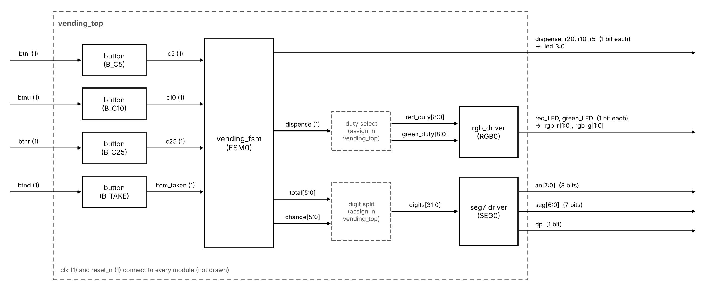

# Lab 9 – Vending Machine

**Course:** ECE 2300L – Digital Logic Design Laboratory
**Board:** Nexys A7-100T
**Tools:** Verilog, Xilinx Vivado

## Files

| File | Description |
|---|---|
| `vending_top.v` | Top-level module connecting the buttons, vending FSM, LEDs, RGB LED, and seven-segment display |
| `vending_fsm.v` | Moore FSM for the vending machine (25¢ item, nickels/dimes/quarters, change outputs) |
| `seg7_driver.v` | Multiplexed driver for the 8-digit seven-segment display |
| `button.v` | Button wrapper combining the debouncer and edge detector |
| `debouncer_delayed.v` | Debouncer with a 20 ms delay timer |
| `debouncer_delayed_fsm.v` | FSM used by the debouncer |
| `edge_detector.v` | Edge detector that produces a one-clock pulse on a button press |
| `timer_parameter.v` | Timer with a fixed final value (parameter) |
| `rgb_driver.v` | Drives the red, green, and blue PWM channels of the RGB LED |
| `pwm_improved.v` | PWM generator with adjustable duty cycle |
| `timer_input.v` | Timer with a final value set by an input |
| `vending_fsm_tb.v` | Self-checking testbench for the vending FSM |
| `seg7_driver_tb.v` | Self-checking testbench for the seven-segment driver |
| `nexys_a7_100t.xdc` | Pin constraints for the Nexys A7-100T |

## Part 1 – Vending Machine

A vending machine controller for a 25¢ item that accepts nickels, dimes, and quarters, built around a Moore FSM. It dispenses the item and returns change on the `r5`, `r10`, and `r20` LEDs, and the seven-segment display shows the total inserted and the change due. The FSM and the display driver were verified with self-checking testbenches.

**Simulation screenshot:**

**Block diagram:**

**Demo video:**

